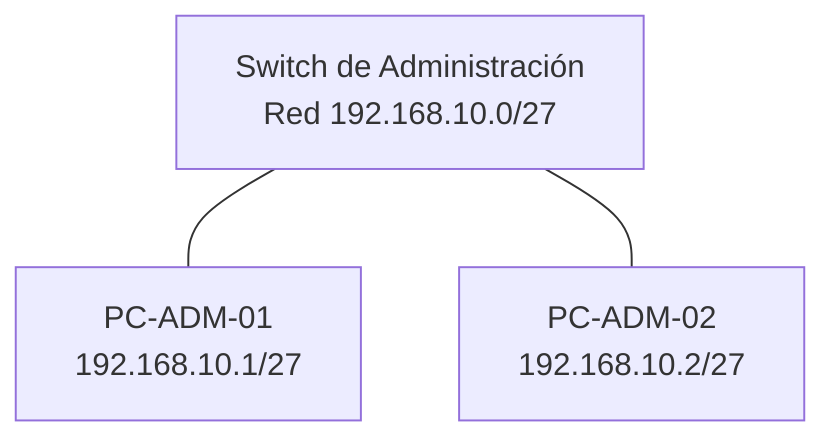

# Subnetting y diseño de direccionamiento IPv4

## Objetivo

Calcular la red, el broadcast y el rango de hosts de una dirección IPv4; elegir prefijos según el número de dispositivos y detectar errores de direccionamiento.

## Cálculos de subred

| IP y prefijo | Red | Broadcast | Primer host | Último host | Hosts útiles |
| --- | --- | --- | --- | --- | --- |
| `10.50.23.141/27` | `10.50.23.128` | `10.50.23.159` | `10.50.23.129` | `10.50.23.158` | 30 |
| `172.19.8.202/28` | `172.19.8.192` | `172.19.8.207` | `172.19.8.193` | `172.19.8.206` | 14 |
| `192.168.77.14/30` | `192.168.77.12` | `192.168.77.15` | `192.168.77.13` | `192.168.77.14` | 2 |

Para `/27` quedan cinco bits de host: `2^5 = 32` direcciones y 30 hosts útiles en una subred IPv4 convencional. La máscara es `255.255.255.224` y el salto en el último octeto es `256 - 224 = 32`.

En `10.40.6.173/27`, la operación AND del último octeto permite obtener la red:

```text
IP:       10101101   173
Máscara:  11100000   224
AND:      10100000   160

Red: 10.40.6.160/27
```

## Diseño de tres LAN independientes

| LAN | Necesidad | Red y prefijo | Máscara | Rango útil | Broadcast |
| --- | --- | --- | --- | --- | --- |
| Administración | 20 hosts | `192.168.10.0/27` | `255.255.255.224` | `.1`–`.30` | `192.168.10.31` |
| Sistemas | 50 hosts | `192.168.20.0/26` | `255.255.255.192` | `.1`–`.62` | `192.168.20.63` |
| Laboratorio | 10 hosts | `192.168.30.0/28` | `255.255.255.240` | `.1`–`.14` | `192.168.30.15` |



No hay router en este diseño. El gateway queda vacío y las tres LAN no tienen comunicación entre sí. El diagrama representa una de ellas, no una simulación ejecutada.

## Diagnóstico

En la red `10.10.10.64/26`, la dirección `.64` identifica la red y `.127` es el broadcast. Ninguna puede asignarse como dirección de un equipo.

Un equipo con `10.10.10.70/26` puede tener una IP válida y, al mismo tiempo, un gateway incorrecto si se configura `10.10.11.1`. La revisión de IP, máscara y gateway debe hacerse conjuntamente.

Para una oficina con 29 dispositivos y 8 ampliaciones previstas, `/27` no basta: sus 30 hosts útiles son menos que los 37 necesarios. `/26` permite 62.

## Verificación de los cálculos

Las tres subredes de la primera tabla y las tres LAN del diseño se contrastaron con `ipaddress` de la biblioteca estándar de Python durante la preparación del repositorio. Esto comprueba la aritmética de las direcciones; no comprueba cableado, dispositivos ni conectividad.

## Conclusión

Documentar la red, el rango asignable y la capacidad permite detectar errores y planificar ampliaciones. Dos hosts de subredes distintas necesitan un dispositivo que enrute entre ellas, aunque compartan infraestructura Ethernet.
